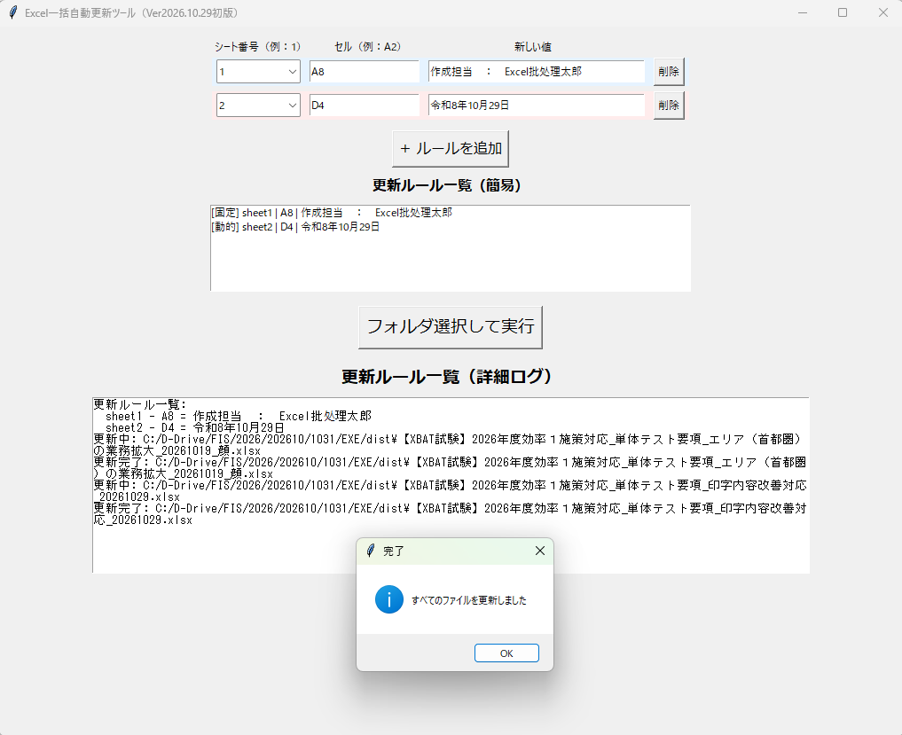

# XBAT

Excel Batch Auto-Update Tool

XBAT 是一个用于批量更新 Excel 数据的 Windows 桌面工具。

通过图形界面操作，无需编写代码，即可快速对指定工作表中的数据进行批量更新，提高日常 Excel 处理效率。

---

## 功能特点

✅ 图形界面操作

✅ 支持批量处理 Excel 文件

✅ 支持动态添加更新规则

✅ 支持工作表（Sheet）选择

✅ 支持批量修改指定单元格内容

✅ 无需安装 Python

✅ 生成独立 EXE，可直接运行

---

## 运行环境

- Windows 10 / 11
- Microsoft Excel 文件（.xlsx）

---

## 下载

请前往 Releases 页面下载最新版本：

https://github.com/huaxia-tech/XBAT/releases

---

## 使用方法

### 1. 启动程序

双击：

```text
XBAT.exe
```
[📥 下载最新 XBAT.exe](https://raw.githubusercontent.com/huaxia-tech/XBAT/main/XBAT.exe)
### 2. 选择 Excel 文件

点击文件选择按钮。

### 3. 配置更新内容

设置：

- Sheet 名称
- 更新字段
- 更新值

### 4. 执行批量更新

点击执行按钮。

程序会自动更新目标文件。

---

## 项目截图

后续添加

```text
screenshots/main.png
```

示例：



---

## 技术栈

- Python 3.11
- Tkinter
- openpyxl
- PyInstaller

---

## 开发计划

### v0.1.0

- 基础批量更新功能
- GUI界面

### v0.2.0

- 更新规则保存
- 配置文件导入导出

### v0.3.0

- 操作日志
- 批量目录处理

### v1.0.0

- 完整发布版

---

## License

MIT License

---

## 作者

顔建霖

GitHub:

https://github.com/huaxia-tech

网站：

https://huaxia-tech.github.io/
